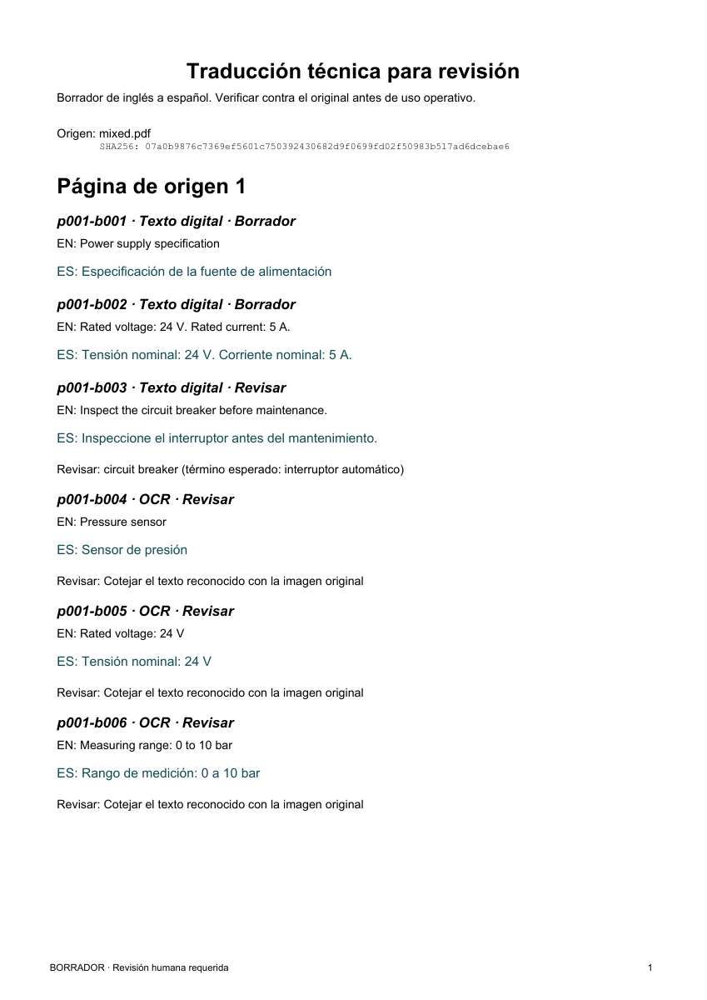

# Revisión bilingüe de fichas técnicas

Herramienta local en Python para revisar documentos industriales de inglés a español. Un técnico recibe el original, un PDF que permite cotejar ambos idiomas y un registro por bloque que identifica la página, la ubicación y el motivo de cada alerta.

**Ejemplo de una ficha de alimentación y presión.** La página contiene tres líneas digitales y otras tres dentro de una imagen. Con OCR se recuperaron las seis. En la instrucción de mantenimiento, Marian tradujo *circuit breaker* por «interruptor». El informe señala el bloque y muestra el término esperado del glosario, «interruptor automático», para que el revisor decida.

[Abrir la ficha original](examples/fixtures/mixed.pdf) · [Leer el PDF bilingüe](examples/review/review.pdf) · [Inspeccionar el JSON del caso](examples/review/review.json)

<details>
<summary>Ver la página de revisión</summary>



</details>

## Resultados reproducibles

| Pregunta | Resultado en seis documentos sintéticos propios |
| --- | --- |
| ¿Qué texto reconoció el extractor? | 140 de 140 líneas de referencia con OCR. Con OCR desactivado faltaron tres líneas en la ficha escaneada y tres en la mixta. |
| ¿Se mantuvieron los registros de inspección? | En el documento largo, 120 de 120 identificadores en su línea de traducción. La versión que agrupaba registros conservó 43 de los 120 en sus bloques. |
| ¿Qué ocurre con las estructuras? | El ejemplo de tabla conserva sus tres filas en el idioma de origen. La ecuación también se conserva para cotejarla con el original. |
| ¿Qué llegó al PDF? | En las 11 páginas de revisión se encontraron todos los campos de texto esperados. Se verificó la igualdad byte a byte de los seis originales. |

El estudio separa la extracción, la traducción y la maquetación. Un número conservado puede acompañar una instrucción mal traducida. La decisión de usar una instrucción sigue correspondiendo al revisor técnico. [Método, resultados por caso y limitaciones](docs/VALIDATION.md)

## Ejecutar el ejemplo

Requisitos: Python 3.11 a 3.13 y [uv](https://docs.astral.sh/uv/). El modo de imágenes requiere [Tesseract con los datos de inglés](https://tesseract-ocr.github.io/tessdoc/Installation.html). Comprueba que `tesseract --list-langs` incluya `eng`. En Windows se puede indicar el ejecutable mediante `TESSERACT_CMD`.

```bash
git clone https://github.com/GzoC/ai_book_translator.git
cd ai_book_translator
uv sync --locked --extra model
uv run --no-sync technical-review examples/fixtures/mixed.pdf --ocr images --output-dir var/ficha --download-model
```

La primera ejecución permite descargar los pesos públicos de [Marian EN-ES](https://huggingface.co/Helsinki-NLP/opus-mt-en-es). Para repetirla, elige otra carpeta de salida y omite `--download-model` para usar la caché. El contenido del PDF se procesa en el equipo. Para probar solo texto digital, usa `examples/fixtures/digital.pdf` con el modo predeterminado `--ocr off`.

| Archivo de salida | Uso |
| --- | --- |
| `original.pdf` | Consultar el diseño, las imágenes y los símbolos del documento recibido. |
| `review.pdf` | Leer cada bloque con su identificador y cotejar el inglés con el borrador en español. |
| `review.json` | Auditar el SHA-256 de la fuente, la revisión del modelo, las cajas en puntos PDF, el origen digital/OCR, el glosario y las alertas. |

Puedes reemplazar el glosario con `--glossary examples/glossary.json`. Es un mapa de términos en inglés a la expresión preferida en español. Una discrepancia queda visible en el informe y se conserva la predicción del modelo.

## Diseño y alcance

PyMuPDF extrae el texto digital y localiza imágenes incluso en páginas mixtas. Tesseract reconoce el inglés de esas regiones. Marian traduce localmente y el control posterior compara cifras, unidades, pares valor-unidad y términos del glosario. ReportLab distribuye los bloques en páginas nuevas. Si falla la generación de un bloque, el lector recibe el texto original con una alerta.

Se admiten PDF de 1 a 50 páginas, sin cifrar y con rotación de página cero. El orden de lectura por posición funciona mejor en fichas de una columna. La detección de tablas y ecuaciones es heurística. Símbolos complejos, texto trazado como vectores, manuscritos y diseños multicolumna requieren revisión directa del original. La comprobación de unidades utiliza una lista explícita y compara formas literales. [Código de los controles](technical_review/quality.py)

## Desarrollo

```bash
uv sync --locked --extra dev
uv run --no-sync pytest -q
uv run --no-sync ruff check technical_review tests scripts
uv build
```

La CI ejecuta pruebas con OCR en Python 3.11 y 3.13 y verifica los paquetes fuera del repositorio. Los pesos de traducción se validan por separado en el estudio publicado. [Workflow](.github/workflows/ci.yml) · [Reproducir el estudio](docs/VALIDATION.md) · [Procedencia y licencias](docs/PROVENANCE.md) · [Prototipo original](legacy/original)
